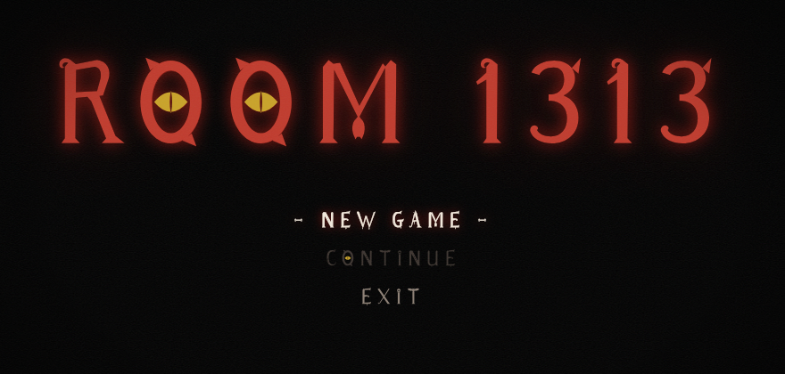
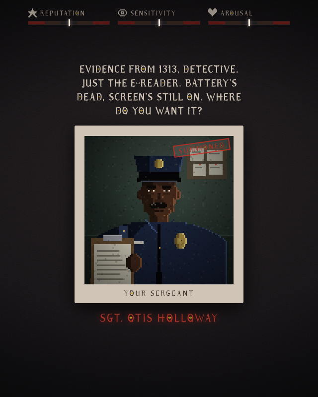
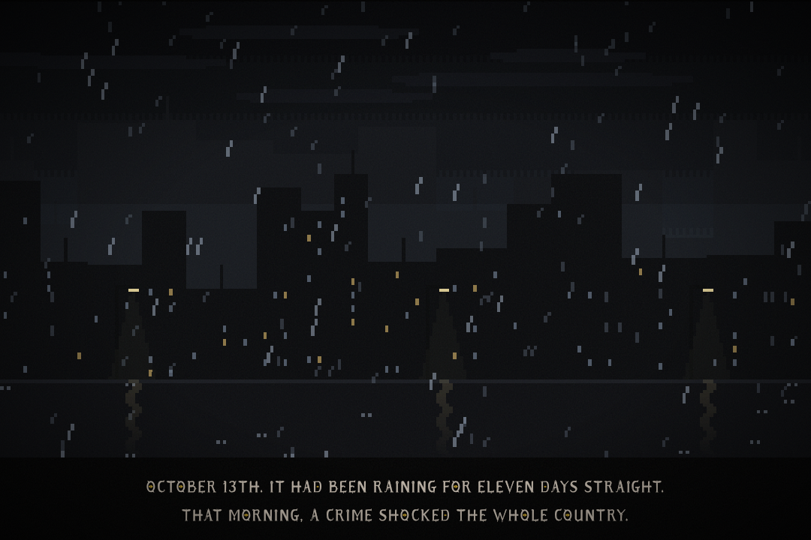

# ROOM 1313

> *October 13th. It had been raining for eleven days straight.*
> *Two guests checked into room 1313 of the Hotel Lumen. Then they vanished.*

A pixel-art horror card game in the spirit of *Reigns*: swipe left or right on
everyone who walks into your office, and try to keep your mind, your body and
your name in one piece long enough to learn what happened in room 1313.

Written in Rust, compiled to WebAssembly, and running in your browser. The
pixel art and every note of the music are generated in code: no image or audio
files.



## The game

You're the new detective on **Case 358**. Witnesses, suspects, cranks and
things that shouldn't exist sit across your desk, one card at a time. Every
answer moves three gauges:

| | Too low | Too high |
|---|---|---|
| **Reputation** | dismissed, badge on the captain's desk | too famous to live: a drive-by |
| **Sensitivity** | haunted by what you can't see | committed, and nobody believes you |
| **Arousal** | collapse and coma | your heart gives out |

Push any of them to 0 or 100 and you get one of **six game-over cinematics**,
each with its own score: noir lament, thrash metal, psychobilly, a broken music
box, a requiem, and hardcore punk that stops dead when you hit the floor.

<p align="center"></p>

Keep your balance and the real case opens up. Sgt. Holloway hands you a broken
e-reader. A shadow whispers. Then come a podcast, an occultist with a door under
the city, and a prophet whose immersions might kill you. Survive all of it and
you might just hear **the truth**.

Along the way: a sergeant with useless clues, a hotel owner who hates you for
the publicity, a reporter riding the case to fame, an occultist who'll invoice
you for an exorcism, two loud idiots with theories, and an Agent you'll wish
you'd never met. Also, a cat.



## Play it

Needs [rustup](https://rustup.rs) and `python3`.

```sh
make setup   # once per machine: wasm target + wasm-pack
make run     # build, then serve at http://localhost:8765
```

Drag the card with the mouse or a finger. In cutscenes, click or press Space
to move on, and Escape to skip. Headphones recommended.

`make help` lists everything else (`dev`, `test`, `lint`, `check`, `release`,
`clean`…). Use another port with `make serve PORT=9000`.

### Shortcuts for testing

Open one of these, then pick **New Game**:

| Link | What it does |
|---|---|
| `#cards` | Skip the intro |
| `#card=<id>` | Start on that card, holding the items it needs (e.g. `#card=prophet_first`) |
| `#ending=<name>` | Watch an ending: `dismissal`, `assassination`, `haunting`, `institution`, `coma`, `overload`, `truth` |
| `#credits` | Roll the credits |

## Under the hood

- **Rust → WebAssembly**, DOM driven from Rust with `web-sys`. The JavaScript
  only loads the module.
- **Pixel art in code:** every cutscene shot is a function of time painted on
  a 240×135 canvas and scaled up with crisp pixels. Card portraits are 96×96.
- **Music in code:** a small Web Audio step sequencer with a synth band (drums,
  distorted guitar, slap bass, piano, strings, a noir horn, a music box).
- **A tested game:** the engine is pure Rust with unit tests. A bot plays the
  real deck 300 times on every `cargo test`, to keep the main quest
  winnable but hard (about 73% for a careful player, about 110 cards).

More in [`GAME.md`](GAME.md) (design, attributes, the quest) and
[`CINEMATICS.md`](CINEMATICS.md) (how the cutscenes and music are made).

## Credits

A game by **bin & zed**. Made in **São Paulo, SP, Brazil**.

Built 100% with **Claude Opus 5.5**.
